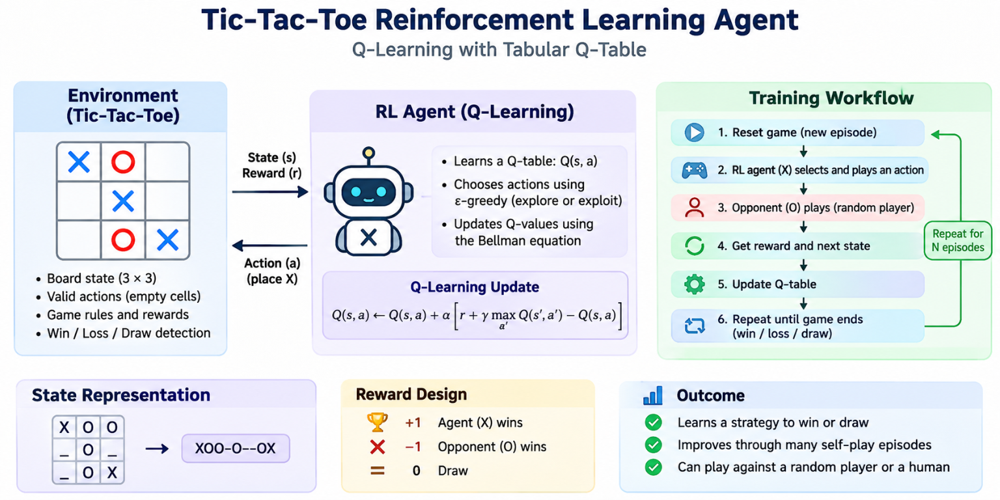

# Tic-Tac-Toe Learns to Play

> A small reinforcement learning project where an agent learns Tic-Tac-Toe by playing thousands of games.

## What is inside?

This project uses a **Q-table** to help the agent remember which moves are useful. It learns by:

- receiving a reward for winning, losing, or drawing;
- exploring new moves;
- improving its choices after every game;
- playing against a random opponent and a human player.

The full process is explained in the Jupyter notebook: [`tic-tac-toe.ipynb`](./tic-tac-toe.ipynb).

## Run it

1. Install Python and Jupyter Notebook.
2. Open `tic-tac-toe.ipynb`.
3. Run the cells from top to bottom.
4. Watch the agent train, then play against it.

## Goal

This project makes reinforcement learning easy to see: the agent starts without knowing how to play and gradually learns through experience.
